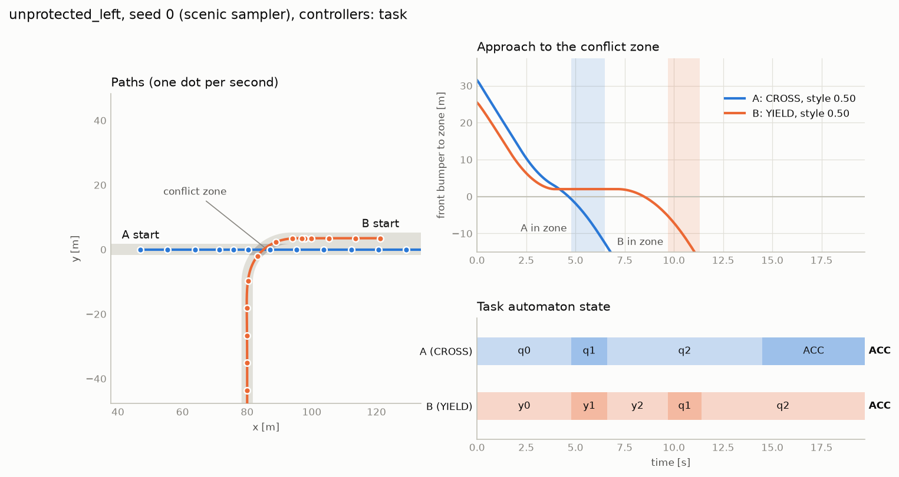

# dfa-drive

Research prototype: **multi-agent driving where each vehicle has its own task automaton.**

    world state + own DFA state + own style  ->  low-level action

The DFA says *what* a vehicle must accomplish. The style scalar says *how* it drives.
The policy (scripted for now, learned later) decides the steering and acceleration.

**Status (2026-10-08).** One scenario (unprotected left turn, two vehicles), three task
DFAs over a six-symbol alphabet, two scripted controllers, trajectory logging and
metrics, validated on 1,800 simulated episodes. No policy has been trained; the
interface for one is in place and the algorithm choice is the next open decision.

## Read first

| Document | Contents |
|---|---|
| [docs/01_related_work_reuse.md](docs/01_related_work_reuse.md) | What ACC-MARL, DGRM, LTL2Action, DeepLTL, Scenic and MetaDrive actually do, and what we reuse |
| [docs/02_architecture.md](docs/02_architecture.md) | Architecture and decision log (alternatives, evidence, what would change each decision) |
| [docs/03_tasks.md](docs/03_tasks.md) | Vocabulary and the three DFAs as transition tables and diagrams (generated from code) |
| [docs/04_validation.md](docs/04_validation.md) | Scripted-controller results: what succeeds, what fails, and why |
| [docs/results/](docs/results/) | The episode tables behind docs/04 |

## Setup

Python 3.11 is required (MetaDrive does not support 3.12 yet).

```bash
python3.11 -m venv ~/.venvs/dfa-drive
ln -s ~/.venvs/dfa-drive .venv
.venv/bin/pip install -e ".[scenic,viz,dev]"
```

The venv lives outside the project because this folder is cloud-synced; on another
machine a plain `python3.11 -m venv .venv` is fine. For the exact versions used for the
reported results, install `requirements.lock.txt` first. MetaDrive fetches its assets
(about 170 MB) the first time it is imported. Without the `scenic` extra everything still runs, using the
NumPy sampler.

```bash
.venv/bin/python -m pytest                # 24 tests, about 5 s
.venv/bin/python -m pytest -m "not sim"   # without the simulator
```

## Run

```bash
# one episode: A must cross, B must yield
.venv/bin/python scripts/run_episode.py --seed 0

# incompatible tasks, both aggressive
.venv/bin/python scripts/run_episode.py --seed 0 --task-a GO_FIRST --task-b GO_FIRST --style-a 0.9 --style-b 0.9

# negative control: controllers that ignore each other
.venv/bin/python scripts/run_episode.py --seed 0 --task-a CROSS --task-b CROSS --controller blind

# figure of a recorded episode
.venv/bin/python scripts/plot_episode.py runs/episodes/CROSS-YIELD_task_seed0.npz

# the validation matrix behind docs/04 (9 task pairs x 9 style pairs x 20 seeds)
.venv/bin/python scripts/run_matrix.py --name validation --seeds 20 --styles 0.1 0.5 0.9
```



## Layout

```
dfadrive/
  world.py         routes, agent/world state, conflict-zone geometry   (world facts)
  labels.py        four facts per agent -> one of six symbols          (world facts)
  tasks.py         CROSS, YIELD, GO_FIRST as dfa.DFA; TaskMonitor      (task state)
  style.py         style scalar -> four driving parameters
  policy.py        Policy interface, AgentView, flat observation for networks
  controllers.py   TaskController (reads its DFA), RouteFollower (blind)
  scenario.py      ScenarioInstance; Scenic and NumPy samplers
  scenarios/unprotected_left.scenic
  sim/metadrive_adapter.py   the only module that imports MetaDrive
  env.py           episode loop: simulator -> facts -> DFAs -> policy views
  recorder.py      one .npz per episode, metadata included
  metrics.py       task outcome, order, post-encroachment time, realised style
scripts/           run_episode, run_matrix, plot_episode, render_tasks, calibrate_vehicle
tests/
```

## Scenario parameters

All in [dfadrive/scenarios/unprotected_left.scenic](dfadrive/scenarios/unprotected_left.scenic):
task per agent, style per agent, initial speeds, A's distance to the conflict zone, and
the nominal arrival-time offset between the two (which fixes B's distance). Routes are
`(entry arm, manoeuvre)` pairs in `dfadrive/scenario.py`. Any parameter can be fixed from
Python: `make_sampler(task_B="GO_FIRST", style_A=0.9, arrival_offset=0.0).sample(seed)`.

## Reproducibility

- An episode is determined by its `ScenarioInstance` and the controller names; both are
  stored in every recording, together with package versions.
- A seed identifies an episode *within one sampler* (Scenic and NumPy use different
  random streams; the sampler name is recorded).
- A single episode replays bit for bit from a fresh simulator (`make_env(exact=True)`;
  `run_episode.py` always does this). A sweep reuses one simulator, which drifts by
  about 1e-6 m between episodes; the sweep as a whole is still reproducible (same
  command, same order, identical CSV). Details in docs/02.
- MetaDrive is pinned to a commit, not a release; see docs/02 for why.

## Known limits

- Exactly two agents and one conflict zone.
- The scripted controller extrapolates the other vehicle at constant speed and does not
  know its task or style.
- "Aggressive" and "conservative" are one axis; the validation shows where that is too coarse.
- The ITSC 2026 reward-machine paper named in the brief could not be found and is not in
  the related-work matrix.
