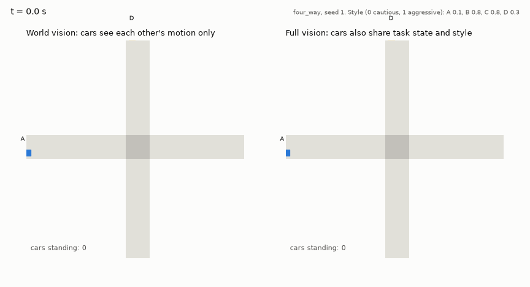
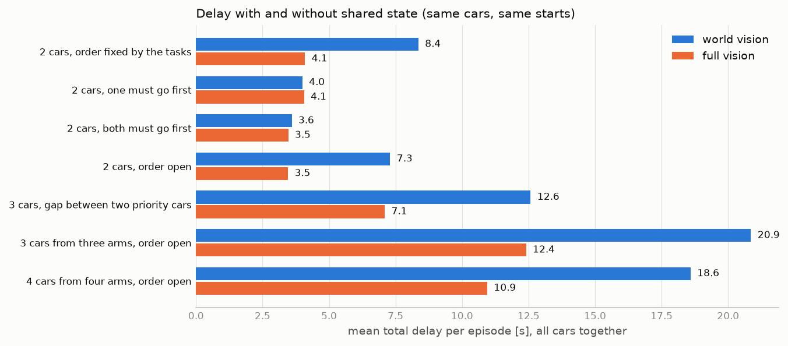

# Does sharing state make cars at an intersection more efficient?

*Brief report, 2026-10-12. Details, decisions and earlier steps are in [docs/](docs/).*

## Summary

Cars meet at an intersection without traffic lights. Each car has its own task (a small
automaton) and its own driving style. We compare two kinds of drivers on identical
situations:

- **World vision**: a car sees where the other cars are and how fast they move, like a
  human driver.
- **Full vision**: a car also sees every other car's task, how far along that task it is,
  its style, and what it is currently doing. Nothing else is exchanged.

Over 2,250 situations, each driven once per vision:

- **Full vision cut total delay by 41–52%** wherever the order of the cars was not obvious
  from their motion, and by 44–51% even when the tasks already fixed the order, because
  the car with priority no longer hesitates.
- **It removed every collision** (6 with world vision, 0 with full vision) and every
  avoidable task failure (61 with world vision, 0 with full vision).
- **It made style legible**: with full vision the more aggressive car goes first in
  93–100% of open cases; with world vision in 40–82%.
- **It is not free of cost**: the gains go mostly to aggressive cars, and in 7% of
  four-car situations the simple schedule we use did worse than world vision.

These are hand-written drivers. A learned driver exists and works with both visions on one
task pairing; the learned comparison is the next experiment.

## Demo

Four cars arrive together from four directions; nobody has priority. Same cars, same
starts. Left: world vision. Right: full vision.



With world vision the intersection is clear after 13.2 s and the cars lose 21.0 s between
them. With full vision the two cars whose paths do not cross go together: clear after
9.5 s, 7.3 s lost. A three-car example is in [docs/figures/demo_gap.gif](docs/figures/demo_gap.gif).

## 1. What we read, and what we took from it

| Work | What it does | What we took |
|---|---|---|
| ACC-MARL (Yalcinkaya et al., ICML 2026) | One shared policy; each agent is given a task automaton at run time; agents see all automata | The idea of one automaton per agent, shared-policy PPO, and its automaton library. Its training code needs a simulator written in JAX, so we could not reuse it |
| DGRM (Hu et al., 2021) | One reward machine per agent on an interaction graph | Confirmation that per-agent machines scale; nothing to reuse at two to four agents, no public code |
| LTL2Action (Vaezipoor et al., ICML 2021), DeepLTL (Jackermeier & Abate, ICLR 2025) | A single agent follows unseen temporal-logic instructions, including continuous control | How a task representation is fed to a policy; the "reach this, avoid that" reading of an automaton |
| Scenic, MetaDrive | Scenario description language; multi-agent driving simulator | Scenic samples our scenarios; MetaDrive runs them. Scenic's own MetaDrive link is single-agent and ten times slower, so Scenic does not run the simulation |

None of these separates *what* an agent must do from *how* it does it, and none studies
agents with conflicting individual tasks. Those two points are what this prototype adds.
One paper from the reading list (reward machines for traffic rules, ITSC 2026) could not
be found. Full matrix: [docs/01](docs/01_related_work_reuse.md).

## 2. Setup

- **Simulator**: MetaDrive, one four-way intersection, one lane per direction, 10 decisions
  per second.
- **Task**: each car holds one of three automata. `CROSS`: reach the goal without crashing.
  `YIELD`: also, do not enter the conflict zone before another car has passed.
  `GO_FIRST`: also, enter before any other car. A task ends accepted, rejected or
  unfinished. Definitions: [docs/03](docs/03_tasks.md).
- **Style**: one number from 0 (cautious) to 1 (aggressive) that sets preferred speed,
  acceleration, braking and the time margin the car wants. The task never reads it.
- **Control**: every car sets its own speed; steering follows its route.
- **Drivers**:
  - *World vision*: follows its task; for the others it extrapolates their current speed and
    goes only with its style's time margin, ahead of or behind them.
  - *Full vision*: every car computes the same schedule for the intersection from the
    shared information and holds back only if its own slot is later than its arrival.
    Cars that cannot stop come first, then cars whose task requires it, then the others
    in order of arrival time plus style margin. Cars whose paths do not cross may go together.

## 3. Experiment

**Design.** Paired. Each situation (positions, speeds, tasks, styles) is sampled once from a
seeded scenario file and driven twice, once per vision. The only difference between the two
runs is what the drivers may know.

**Situations** (2,250 in total, 4,500 episodes):

| Cars | Scenario | What varies |
|---|---|---|
| 2 | left turn across oncoming traffic, with random timing, with a tie, from a standing start; right-angle crossing with a tie | 5 task pairings × 9 style pairs × 10 seeds each (1,800) |
| 3 | two priority cars a few seconds apart, a third must yield and may use the gap | yielder's style × gap of 2–6 s × 10 seeds (150) |
| 3 | three cars from three directions, arriving together, nobody has priority | random styles, 150 seeds |
| 4 | four cars from four directions, arriving together, nobody has priority | random styles, 150 seeds |

**Measures.** *Delay* of a car: time to reach its goal minus the time it would need on an
empty road at its own style; summed over the cars of an episode. Also: tasks accepted,
collisions, time spent standing still, and who enters first.

## 4. Results



| Situation | Instances | All tasks done, world / full | Collisions, world / full | Delay, world | Delay, full | Saved (95% interval) | Full better / worse |
|---|---|---|---|---|---|---|---|
| 2 cars, order fixed by the tasks | 360 | 360 / 360 | 0 / 0 | 8.4 s | 4.1 s | 4.3 s (4.0 to 4.5) | 91% / 0% |
| 2 cars, one must go first | 720 | 659 / 720 | 0 / 0 | 4.0 s | 4.1 s | −0.1 s (−0.2 to 0.0) | 19% / 8% |
| 2 cars, both must go first | 360 | 0 / 0 | 6 / 0 | 3.6 s | 3.5 s | 0.1 s (0.1 to 0.2) | 11% / 1% |
| 2 cars, order open | 360 | 360 / 360 | 0 / 0 | 7.3 s | 3.5 s | 3.8 s (3.6 to 4.0) | 84% / 0% |
| 3 cars, gap between two priority cars | 150 | 150 / 150 | 0 / 0 | 12.6 s | 7.1 s | 5.5 s (5.0 to 5.9) | 96% / 0% |
| 3 cars, three directions, order open | 150 | 150 / 150 | 0 / 0 | 20.9 s | 12.4 s | 8.5 s (8.1 to 8.9) | 100% / 0% |
| 4 cars, four directions, order open | 150 | 150 / 150 | 0 / 0 | 18.6 s | 10.9 s | 7.6 s (6.9 to 8.3) | 91% / 7% |

"Better / worse": full vision saves / costs more than 0.5 s in that instance. "All tasks
done" is zero by construction when both cars must go first: only one can.

**What the numbers say**

1. **Knowing intent removes hesitation.** The largest two-car saving is where the tasks
   already fix the order. With world vision the car that has priority cannot know the other
   will yield, so it slows down; with full vision it drives through.
2. **Where tasks conflict, sharing state buys safety and success, not time.** When one or
   both cars must go first, delay is the same, but world vision produced all 6 collisions
   and failed 61 tasks that full vision completed.
3. **The benefit grows with the number of cars**, from about 4 s with two cars to about 8 s
   with three or four, because the shared schedule lets non-conflicting cars cross together
   and nobody waits for a car that is itself waiting.
4. **Style becomes predictable.** With the order open, the more aggressive car goes first
   in 93–100% of full-vision episodes (68%, 82%, 82%, 40% with world vision across the four
   two-car scenarios). From a standing start, world-vision precedence is close to arbitrary.
5. **The classic gap test separates styles only with full vision.** A yielding car takes
   the gap between two priority cars when it is at least 5 s (cautious) or 3 s (middle,
   aggressive). With world vision it took the gap in 5 of 150 episodes, because the first
   priority car hesitates and the gap closes.

**Where full vision does not help, or hurts**

- **The cautious car does not gain.** In the four-car scene the most aggressive car's delay
  falls from 3.7 s to 0.5 s; the most cautious car's goes from 4.9 s to 5.2 s.
- **In 11 of 150 four-car situations full vision was worse**, by up to 3.3 s. The schedule
  serves cars in strict priority order and is not optimal.
- **Taking a gap costs someone else.** With full vision the yielding car takes the gap in
  100 of 150 episodes, and the second priority car's mean delay is 2.2 s, against 0.9 s
  with world vision.

## 5. Learned drivers (status)

One shared PPO policy, trained by self-play on one pairing (one car crosses, one yields),
with a reward made of task outcome, progress shaping, a collision penalty and style costs.
With either vision it completes both tasks in 180 of 180 held-out situations without a
collision, and its free-road speed follows its style. On this pairing the two visions
perform the same, as expected: the tasks leave nothing to coordinate. Getting there took
two reward corrections and a change of the policy's output from acceleration to target
speed; see [docs/05](docs/05_rl_smoke_test.md) and [docs/07](docs/07_full_vision.md).

## 6. Limits

- The drivers compared here are hand-written. The full-vision schedule is one reasonable
  way to use shared state, chosen by us; a different rule would give different numbers.
- "Sharing" is idealised: complete, instant, honest and free.
- One intersection, at most four cars, one lane per direction, 10 seeds per two-car cell.
- The delay baseline is computed, not simulated; it is the same for both visions, so the
  paired savings do not depend on it.

## 7. Next

1. The same comparison with learned drivers trained on all task pairings, several seeds.
2. Learned drivers for three and four cars.
3. Partial or delayed sharing: how much of the benefit survives if only the task, or only
   the style, is shared.

## Reproduce

```bash
.venv/bin/python scripts/compare_vision.py --name two_car --scenarios unprotected_left tie crossing standing_start \
    --tasks CROSS:CROSS GO_FIRST:GO_FIRST GO_FIRST:CROSS CROSS:GO_FIRST CROSS:YIELD --styles 0.1 0.5 0.9 --seeds 10
.venv/bin/python scripts/compare_vision.py --name multi_car --scenarios three_way four_way --seeds 150
.venv/bin/python scripts/run_gap.py --name gap --seeds 10
.venv/bin/python scripts/analyze_vision.py        # table and figure, from docs/results/vision/
.venv/bin/python scripts/make_demo.py --scenario four_way --seed 1
```
