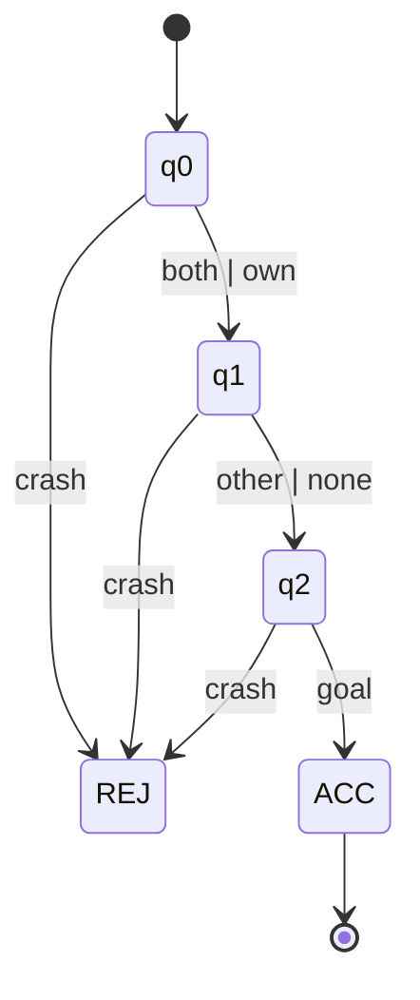
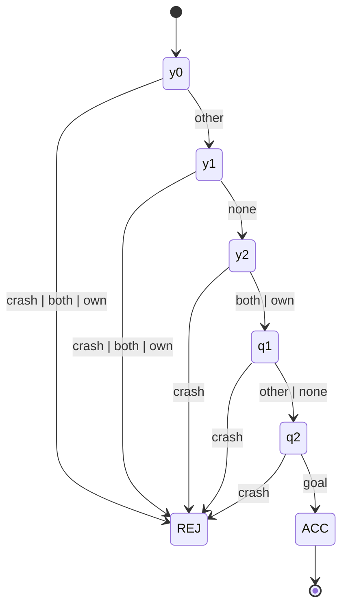
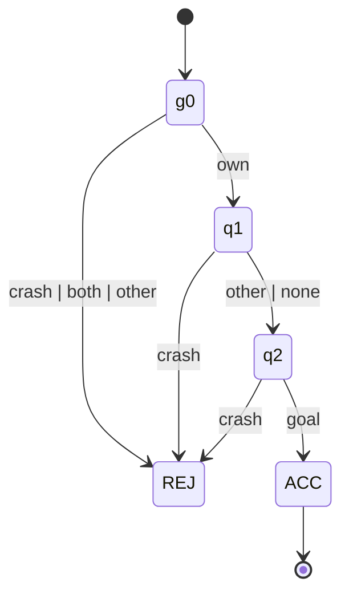

# 03 — Tasks: vocabulary and per-agent DFAs

*Generated by `scripts/render_tasks.py` from `dfadrive/tasks.py` and `dfadrive/labels.py`.
Edit the code, not this file.* Decision record: D2 in [02_architecture.md](02_architecture.md).

## Scenario

Unprotected left turn at a four-way intersection, one lane per direction.
**A** enters from the west and goes straight. **B** enters from the east and turns left
across A's lane. The **conflict zone** is the overlap of the two lane corridors, computed
from the route geometry (`ConflictGeometry.from_routes`).

## Three layers, kept apart

| Layer | Contents | Never contains |
|---|---|---|
| World facts | four booleans per agent, below | anything about tasks or intentions |
| Task state | the agent's current DFA state | speeds, margins, distances |
| Policy decisions | steering and acceleration | — (reads the other two, plus style) |

## World facts (per agent, every step)

| Fact | True when | Source |
|---|---|---|
| `crashed` | this vehicle is in contact with another vehicle, or has left the road | simulator |
| `at_goal` | this vehicle has reached the end of its route | simulator |
| `own_in_cz` | this vehicle's footprint overlaps the conflict zone | geometry |
| `other_in_cz` | the other vehicle's footprint overlaps the conflict zone | geometry |

`other_in_cz` is the only fact about another agent. It is what makes precedence
expressible, and it is a deliberate departure from ACC-MARL, where an agent's DFA reads
labels of its own state only.

## Symbols: one per agent per step

The DFA does not read the four facts directly. They are collapsed, in this priority
order, to exactly one symbol:

| Priority | Symbol | Condition |
|---|---|---|
| 1 | `crash` | `crashed` |
| 2 | `goal` | `at_goal` |
| 3 | `both` | `own_in_cz` and `other_in_cz` |
| 4 | `own` | `own_in_cz` |
| 5 | `other` | `other_in_cz` |
| 6 | `none` | otherwise |

Consequences worth knowing: a higher-priority symbol hides the lower ones in that step
(when an agent reaches its goal, its DFA does not see whether the other is in the zone);
and "cleared the zone" is not a fact at all, it is DFA memory (`own` followed by
`none`/`other`).

## Semantics

- A DFA reads the symbol of every state reached by a simulation step (not the initial state).
- `ACC` and `REJ` are absorbing. Per-agent episode outcome is three-valued:
  **accepted** (in `ACC`), **rejected** (in `REJ`), **unfinished** (time ran out elsewhere).
- An agent whose task is accepted or rejected keeps driving until it physically finishes.
- Reward for a learner: +1 on entering `ACC`, −1 on entering `REJ`, per agent.
- In the tables, `·` means "stay in this state".

## The DFAs

Alphabet: `crash`, `goal`, `both`, `own`, `other`, `none`.

### CROSS

Reach the goal; never crash.

| state | meaning | `crash` | `goal` | `both` | `own` | `other` | `none` |
|---|---|---|---|---|---|---|---|
| **q0** (start) | approaching | REJ | · | q1 | q1 | · | · |
| **q1** | in the conflict zone | REJ | · | · | · | q2 | q2 |
| **q2** | cleared the zone | REJ | ACC | · | · | · | · |
| **ACC** | task accomplished | · | · | · | · | · | · |
| **REJ** | task failed | · | · | · | · | · | · |

### YIELD

Reach the goal; never crash; do not enter the conflict zone until the other has cleared it.

| state | meaning | `crash` | `goal` | `both` | `own` | `other` | `none` |
|---|---|---|---|---|---|---|---|
| **y0** (start) | must wait; the other has not entered yet | REJ | · | REJ | REJ | y1 | · |
| **y1** | must wait; the other is in the zone | REJ | · | REJ | REJ | · | y2 |
| **y2** | the other has cleared; free to go | REJ | · | q1 | q1 | · | · |
| **q1** | in the conflict zone | REJ | · | · | · | q2 | q2 |
| **q2** | cleared the zone | REJ | ACC | · | · | · | · |
| **ACC** | task accomplished | · | · | · | · | · | · |
| **REJ** | task failed | · | · | · | · | · | · |

### GO_FIRST

Reach the goal; never crash; enter the conflict zone before the other does.

| state | meaning | `crash` | `goal` | `both` | `own` | `other` | `none` |
|---|---|---|---|---|---|---|---|
| **g0** (start) | nobody has entered yet | REJ | · | REJ | q1 | REJ | · |
| **q1** | in the conflict zone | REJ | · | · | · | q2 | q2 |
| **q2** | cleared the zone | REJ | ACC | · | · | · | · |
| **ACC** | task accomplished | · | · | · | · | · | · |
| **REJ** | task failed | · | · | · | · | · | · |

## Which pairs can both succeed

| A \ B | CROSS | YIELD | GO_FIRST |
|---|---|---|---|
| **CROSS** | yes, either order | yes, A first | yes, B first |
| **YIELD** | yes, B first | **no**: each waits for the other (deadlock) | yes, B first |
| **GO_FIRST** | yes, A first | yes, A first | **no**: only one can be first |

This table follows from the automata alone. `docs/04_validation.md` checks it against
simulation.

## Notes for later use

- All three DFAs are minimal (checked in `tests/test_tasks.py`) and have at most 7 states
  over 6 symbols, inside the (10 states, 10 tokens) range of the pretrained RAD encoder.
  `Task.token_dfa()` returns the integer-token form that `dfax.dfa2dfax` and
  `rad_embeddings.Encoder` accept.
- For a network input, "own DFA state" is a one-hot over one shared state vocabulary:
  `q0, y0, y1, y2, g0, q1, q2, ACC, REJ`. The tail states `q1`, `q2` are shared across tasks on purpose.
- `TaskMonitor.forbids(symbol)` answers "would this symbol make my task unachievable
  now?". The scripted controller uses only this query, never task or state names, so it
  works unchanged for any DFA over this alphabet.
