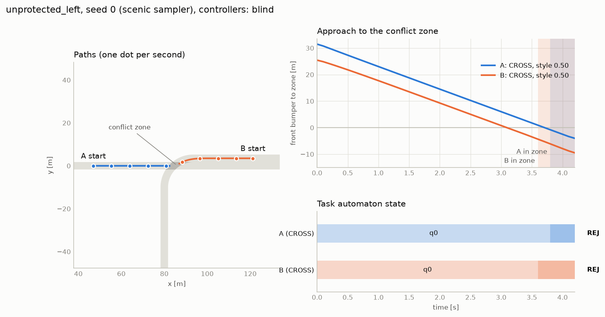
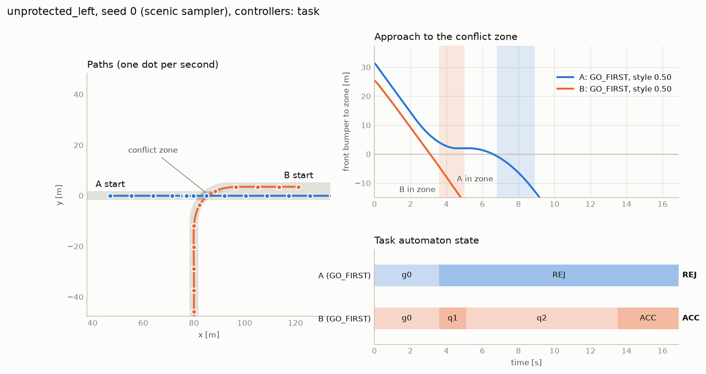

# 04 — Validation with scripted controllers (before any learning)

**Question.** Does the architecture (world facts → per-agent DFA → policy that reads its
DFA and its style) produce the interactions the task definitions predict, and can each
kind of failure be attributed to one layer?

**Answer.** Yes, on this scenario. Every outcome in 1,800 episodes is the one the
automata predict; the failures that occur are task-level (rejection, deadlock) or come
from the deliberately blind controller. Two things did not go as designed and are
reported in §4: style orders precedence only at its extremes, and peak braking does not
follow style.

Data: [results/validation_episodes.csv](results/validation_episodes.csv) (one row per
episode), [results/validation_summary.md](results/validation_summary.md) (all 81
task × style cells), [results/blind_episodes.csv](results/blind_episodes.csv).

## 1. Setup

| | |
|---|---|
| Scenario | unprotected left turn; initial speeds 5–10 m/s, A 25–50 m from the zone, nominal arrival offset −2..2 s (`unprotected_left.scenic`, Scenic sampler) |
| Tasks | all 9 pairs of `CROSS`, `YIELD`, `GO_FIRST` ([03_tasks.md](03_tasks.md)) |
| Styles | 0.1, 0.5, 0.9 for each agent (9 pairs) |
| Seeds | 0–19 per cell, the same 20 initial conditions in every cell |
| Controllers | `TaskController` for both agents (1,620 episodes); `RouteFollower` for both as negative control (180 episodes, `CROSS:CROSS`) |
| Horizon | 40 s; an agent still running then is "unfinished" |
| Command | `python scripts/run_matrix.py --name validation --seeds 20 --styles 0.1 0.5 0.9`, then the same with `--name blind --controller blind --tasks CROSS:CROSS` |

`TaskController` sees the world state, its own DFA state and its own style. It does not
see the other agent's task or style, and extrapolates the other at constant speed.

## 2. Result by task pair (A:B), 180 episodes each

| tasks | both accepted | A outcome | B outcome | collision | timeout | A first | median PET [s] | min gap [m] |
|---|---|---|---|---|---|---|---|---|
| CROSS:CROSS | 100% | accepted 180 | accepted 180 | 0% | 0% | 53% | 2.3 | 1.64 |
| CROSS:YIELD | 100% | accepted 180 | accepted 180 | 0% | 0% | 100% | 3.1 | 1.65 |
| CROSS:GO_FIRST | 83% | accepted 180 | accepted 149, rejected 31 | 0% | 0% | 17% | 1.8 | 1.65 |
| YIELD:CROSS | 100% | accepted 180 | accepted 180 | 0% | 0% | 0% | 1.7 | 3.03 |
| YIELD:YIELD | 0% | unfinished 180 | unfinished 180 | 0% | 100% | – | – | 16.88 |
| YIELD:GO_FIRST | 100% | accepted 180 | accepted 180 | 0% | 0% | 0% | 1.6 | 3.06 |
| GO_FIRST:CROSS | 75% | accepted 135, rejected 45 | accepted 180 | 0% | 0% | 75% | 2.9 | 1.65 |
| GO_FIRST:YIELD | 100% | accepted 180 | accepted 180 | 0% | 0% | 100% | 3.1 | 1.65 |
| GO_FIRST:GO_FIRST | 0% | rejected 109, accepted 71 | accepted 109, rejected 71 | 0% | 0% | 39% | 2.1 | 1.65 |

PET = post-encroachment time: time between the first vehicle leaving the conflict zone
and the second entering it. Smallest PET in any episode: 1.0 s. The 1.65 m minimum gap is
the two cars passing in adjacent lanes, not a near miss.

Against the prediction table in 03:

- **Pairs that can both succeed do, in every episode** where precedence is fixed by the
  tasks (`CROSS:YIELD`, `YIELD:CROSS`, `YIELD:GO_FIRST`, `GO_FIRST:YIELD`) and where it is
  free (`CROSS:CROSS`).
- **`YIELD:YIELD` deadlocks in 180/180**: both stop before the zone and nobody enters.
- **`GO_FIRST:GO_FIRST` has exactly one winner in 180/180**, never two, never a crash.
- **`GO_FIRST` against `CROSS` is satisfiable but not guaranteed**: the `CROSS` agent is
  free to go first, and does so in 76 of 360 episodes.

## 3. Attributing failures

The point of validating before RL is that each failure should have one owner.

| Failure seen | Where | Owner | Evidence |
|---|---|---|---|
| Collision | 88/180 blind episodes; 0/1,620 with `TaskController` | **controller** (and it confirms the **scenario** is a real conflict) | same 20 initial conditions, only the controller differs |
| Deadlock | `YIELD:YIELD`, 180/180 | **task pair** (jointly unsatisfiable) | independent of style and seed; predicted from the automata |
| One agent rejected | `GO_FIRST:GO_FIRST`, 180/180 | **task pair** | exactly one winner every time |
| `GO_FIRST` rejected by a `CROSS` agent | 76/360 | **style and timing**, not the task | 1% when the `GO_FIRST` agent is the more aggressive, 11% at equal styles, 52% when the `CROSS` agent is |
| Task rejected although tasks were compatible | none | — | would indicate a labelling or DFA error |

Blind controllers: collisions in 13/20 episodes when both have the same style and in
2–3/20 when styles are 0.1 vs 0.9, plausibly because very different cruise speeds pull
the arrival times apart. Example:

Same initial conditions with `GO_FIRST:GO_FIRST` and `TaskController`: B enters first, A's
automaton rejects at 3.6 s, A then waits and crosses safely.

## 4. Intent versus style

**What holds.** With the task fixed, style changes *how*, not *whether*:

| `CROSS:YIELD`, by B's style | B enters first | B at goal after | median PET | B standing |
|---|---|---|---|---|
| 0.1 | 0/60 | 24.0 s | 3.6 s | 2.9 s |
| 0.5 | 0/60 | 20.8 s | 3.2 s | 3.6 s |
| 0.9 | 0/60 | 17.9 s | 2.5 s | 3.2 s |

A yielding B never goes first at any style; an aggressive B simply follows A more
closely and finishes sooner. With the task silent on precedence, style decides it:

| `CROSS:CROSS`: A enters first | B = 0.1 | B = 0.5 | B = 0.9 |
|---|---|---|---|
| **A = 0.1** | 60% | 55% | 10% |
| **A = 0.5** | 50% | 60% | 15% |
| **A = 0.9** | 85% | 75% | 65% |

and in `GO_FIRST:GO_FIRST` the more aggressive agent wins 77–88% of the time.

**What does not hold, or only partly.**

1. *Mid-range styles are not separated.* In the table above, 0.1 and 0.5 are
   indistinguishable (50–60% everywhere); only 0.9 stands apart. With 20 seeds per cell
   the standard error is about 11 points, so this is "no visible effect", not proof of
   none. Cause, from traces: when neither agent has a clear lead both slow down, and
   precedence then goes to whoever is still rolling when the other stops, which is not
   a monotone function of style. This is the evidence that would move D3 toward two
   scalars (pace, risk).
2. *Peak braking does not follow style.* Realised mean speed (5.9 / 7.3 / 9.0 m/s) and
   peak acceleration (1.4 / 2.0 / 2.7 m/s²) are monotone in style; mean peak braking is
   not (3.2 / 4.1 / 3.6 m/s²) and exceeds the nominal "comfortable braking" for
   conservative agents. Braking is dictated by how late a stop becomes necessary
   (the closest, fastest starts already need close to 4 m/s² to stop in time), not by
   preference.
3. *The equal-style baseline is not 50%.* A goes first in 62% of equal-style episodes.
   The scenario is not symmetric between A and B (different paths through the zone, and
   B's start distance is derived from A's rather than sampled); the cause was not isolated.

## 5. Issues found while building this, and what they mean

| Finding | Consequence |
|---|---|
| A proportional speed controller overshot the stop line; the controller then considered itself "in" and drove on, so aggressive `YIELD` agents violated their task. | Fixed (constant-deceleration stop law; "before the zone" is now decided by the footprint fact). The DFA caught it immediately as `REJ`, which is the architecture doing its job. |
| First gap-acceptance rule ("clear the zone before the other arrives") made the *conservative* agent go first more often. | Replaced by a lead-time rule. Shows that style needs to be validated by outcome, not by parameter values. |
| MetaDrive's memory grows by **1.3 MB per `reset()`** in the multi-agent intersection env, also in a bare reset/step loop without our code, on macOS arm64. Speed is unaffected (≈ 1,280 steps/s over 400 episodes). | For RL: recycle worker processes every few hundred episodes, and re-measure on the training machine. |
| Rebuilding the engine per episode (`exact=True`) leaks about 4 MB and slows down. | Exact mode is for single-episode replay only. |
| One MetaDrive engine per process. | Vectorised training needs subprocess workers. |
| Episode replay is bit-exact only from a fresh engine; sweeps are reproducible as a whole. | See README, Reproducibility. |

## 6. What this validation does not show

- One scenario, one map, two agents; no multi-lane, signals, or third parties.
- The scripted controller is not a good driver, only a sufficient one: it never collided
  here, but it waits longer than necessary and has no model of the other's intent.
- 20 seeds per cell. Differences below roughly 20 points between cells are not resolved.
- The Python sampler is a different random stream; these numbers are for the Scenic sampler.
- Nothing here says a learned policy will reproduce this; it says the task, labelling,
  scenario and interface are sound enough that a training failure would be a training failure.
