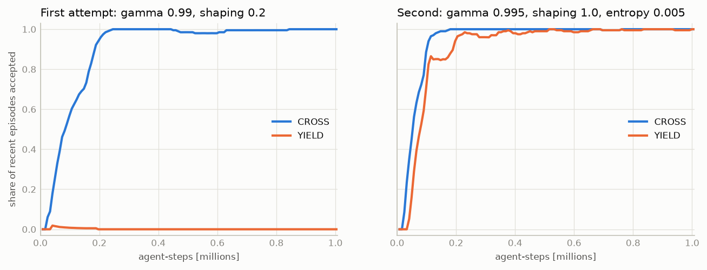
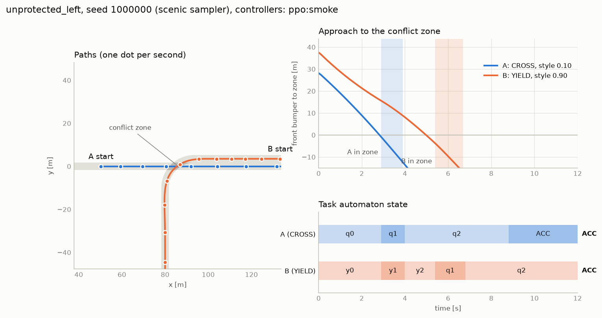

# 05 — First learned policy: smoke test

**Purpose.** Check that the formulation decided in D4 ([02_architecture.md](02_architecture.md))
produces a usable learning signal. This is one seed on one task pair. It is a check that
the pipeline works, not an experiment, and no claim here should be read as a result.

**Outcome.** One shared policy learned both roles of `CROSS:YIELD` in about 0.5 M
agent-steps (4 minutes on a laptop CPU). On 270 held-out scenarios both tasks were
accepted every time with no collision. Style moved the learned behaviour in the intended
direction but its speed preference was ignored; §5 fixes that, and in doing so exposes
one situation in which an aggressive yielder violates its task.

Data: [results/rl_smoke/](results/rl_smoke/) and [results/rl_style_fix/](results/rl_style_fix/)
(configs, training logs, per-episode evaluations).

Sections 1–4 describe the first run with its original reward weights (over-speed 0.05,
margin 0.5). The code defaults are now the weights of §5.

## 1. What was trained

| | |
|---|---|
| Algorithm | PPO (Stable-Baselines3 2.9), **one policy for both agents**, each agent a separate sample stream with its own reward |
| Observation (25 numbers) | own motion along its route (6), the other vehicle in the ego frame (9), own DFA state one-hot (9), own style (1). Nothing about the other's task or style |
| Action | acceleration only, +1 = 3 m/s², −1 = −6 m/s²; steering follows the route |
| Reward | accept +1 / reject −1; potential-based shaping on DFA progress; collision −1; style costs (time, over-speed, over-acceleration, short time gap at zone entry). Exact definition: `dfadrive/rl/reward.py` |
| Tasks | A = `CROSS`, B = `YIELD` in every episode |
| Styles, speeds, distances, timing | sampled per episode from `unprotected_left.scenic` (both styles uniform in [0, 1]) |
| PPO settings | 16 slots (8 simulators), 512 steps per update, batch 1024, 10 epochs, lr 3e-4, γ 0.995, λ 0.95, entropy 0.005, MLP 64-64 |
| Budget | 1.0 M agent-steps, seed 0 |

```bash
.venv/bin/python scripts/train_ppo.py --name smoke --steps 1000000
.venv/bin/python scripts/eval_policy.py runs/rl/smoke/model.zip --seeds 30 --styles 0.1 0.5 0.9 --save-episodes 1
```

## 2. Training



**The first attempt failed, usefully.** With γ = 0.99 and shaping weight 0.2 the
`CROSS` role was learned, but the `YIELD` role converged to *waiting forever*: rejections
fell from 50% to 0%, and 99.5% of its episodes then ran out of time. The agent had
learned what its automaton forbids and never discovered what it rewards. Two causes,
both about the reward's scale rather than its form: at γ = 0.99 the acceptance reward,
some 15 s away, is discounted to about a fifth; and the shaping for approaching the
zone after the other has cleared was smaller than the exploration noise.

**The second attempt** changed three numbers (γ 0.995, shaping 1.0, entropy bonus
0.005). `CROSS` reached 100% acceptance by 0.2 M steps and `YIELD` 97% by 0.25 M and
99–100% from 0.5 M on. During training about 1% of `YIELD` episodes still ended in a
crash while `CROSS` showed none, so these are not collisions with A; most likely B
leaving the road in the turn at speed (not verified).

Throughput: 4,300 agent-steps/s with 8 simulator processes, including PPO updates.

## 3. Evaluation on held-out scenarios

Deterministic actions, both agents running the learned policy, 30 scenarios for each of
the 9 style pairs (seeds disjoint from training), next to the scripted controller on the
same scenarios.

| | learned | scripted |
|---|---|---|
| Both tasks accepted | 270 / 270 | 270 / 270 |
| Collisions | 0 | 0 |
| A enters the zone first | 270 / 270 | 270 / 270 |
| Median / smallest post-encroachment time | 2.3 s / 0.8 s | 2.9 s / 1.9 s |
| B standing still before the zone (mean) | 0.0 s | 3.0 s |
| Time to goal, A / B (mean) | 9.0 s / 14.6 s | 16.0 s / 21.1 s |

The learned B does not stop and wait. It slows early so as to reach the zone just after
A has left it:



**Effect of style on the learned policy** (pooled over the other agent's style, 90 episodes each):

| own style | A mean speed | A peak accel | B mean speed | B peak accel | B time to goal | median PET |
|---|---|---|---|---|---|---|
| 0.1 | 12.1 m/s | 1.3 m/s² | 8.0 m/s | 1.1 m/s² | 15.9 s | 2.7 s |
| 0.5 | 13.4 m/s | 1.7 m/s² | 8.8 m/s | 1.5 m/s² | 14.5 s | 2.3 s |
| 0.9 | 14.6 m/s | 2.2 m/s² | 9.5 m/s | 1.9 m/s² | 13.4 s | 2.0 s |

## 4. What this shows and what it does not

**Shows**

- The interface is sufficient: world state + own DFA state + own style is enough for one
  network to play both roles. The task outcome was never violated at any style.
- Intent and style separate in the learned policy as they do in the scripted one: style
  moves speed, acceleration and the gap to the other car monotonically, and never
  changes who goes first.
- The acceleration limits of each style are respected (peak 1.3 / 1.7 / 2.2 m/s² against
  limits of 1.6 / 2.2 / 2.8).

**Does not show, or shows the opposite**

1. **The style's cruise speed was ignored** in this run: a conservative A averaged
   12.1 m/s where its style prefers at most 6.5 m/s. Fixed in §5.
2. **Gaps were smaller than the style asks for**: 59% of cautious yielders entered with
   less than their 2.75 s margin. Fixed in §5, at a price described there.
3. **One seed, one task pair.** `YIELD:CROSS`, `CROSS:CROSS` and the `GO_FIRST` pairs
   were not trained. The contested pairs are where self-play is expected to be hard.
4. **Easier than the full problem.** Steering was not learned, and the yielding agent's
   opponent was a policy that had already learned to cross promptly.
5. **Reward-scale sensitivity.** The formulation went from failing to working by
   changing γ and one weight. That is a warning about robustness, not a tuned result.

**Known imperfection in the training data.** An agent that finishes before the other
occupies its slot with zero observations and zero rewards until the joint episode ends
(roughly a fifth of all samples late in training, estimated from the arrival times). This is the usual workaround with a stock PPO; exact
masking needs a custom implementation (see the D4 table in 02).

## 5. Reward fix (2026-10-12)

**Change.** Two weights in `RewardConfig`: the over-speed cost 0.05 → 0.5 and the
margin cost 0.5 → 1.5. Nothing else. The arithmetic behind the first: at γ = 0.995 a
second saved is worth roughly 0.06–0.08 of reward, so a cost of 0.05 per second for
driving at double the preferred speed was about break-even, and the policy took it.

**Result.** Same seed, same budget (policy `style_fix`), same 270 held-out scenarios:

| Own style | Target speed | Free-road speed, before → after | Target margin | Yielder's gap below target, before → after |
|---|---|---|---|---|
| 0.1 | 6.5 m/s | 12.5 → **6.5** | 2.75 s | 59% → **0%** |
| 0.5 | 8.5 m/s | 14.2 → **8.4** | 1.75 s | 11% → **3%** |
| 0.9 | 10.5 m/s | 15.7 → **10.3** | 0.75 s | 0% → 9% |

Free-road speed is the mean speed after the zone, where only preference limits it. Peak
acceleration stays inside each style's limit (0.9 / 1.3 / 1.8 m/s² against 1.6 / 2.2 / 2.8).
Training was as fast as before: both roles above 98% acceptance from 0.25 M steps.

**The price.** Both tasks accepted fell from 270/270 to **266/270, with one collision**.
All four failures are in one cell: A cautious (0.1), B aggressive (0.9), with B due to
arrive more than a second before A. Now that the cautious A really is slow, the
aggressive yielder has to wait longer for it, and sometimes enters while A is still in
the zone. [06_style_probes.md](06_style_probes.md) §3 isolates this: in a tie it never
happens (270/270); when the yielder would arrive 1.5 s early it happens in 4 of 60
episodes with an aggressive yielder and in none of 120 otherwise.

So style is now realised as specified, and a real trade-off between task and style has
become visible at the aggressive end. It is one seed; whether it is a training artefact
is not known.

## 6. Suggested next steps

1. Find out whether the aggressive-yielder failure in §5 survives more seeds and longer
   training, and if so whether a larger rejection penalty removes it without flattening style.
2. Train on all nine task pairs with the task pair sampled per episode, and evaluate each
   pair separately against the prediction table in [03_tasks.md](03_tasks.md).
3. Several seeds per configuration before reading anything into differences.
4. Then the questions the project is about: held-out task/style combinations, and
   learned policies against scripted opponents they were not trained with.
